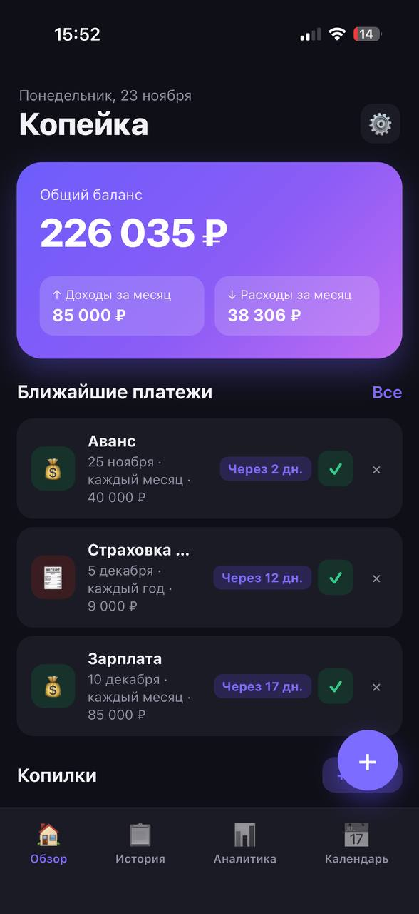
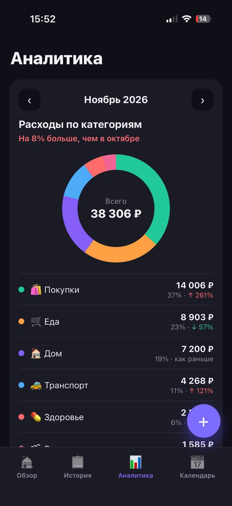
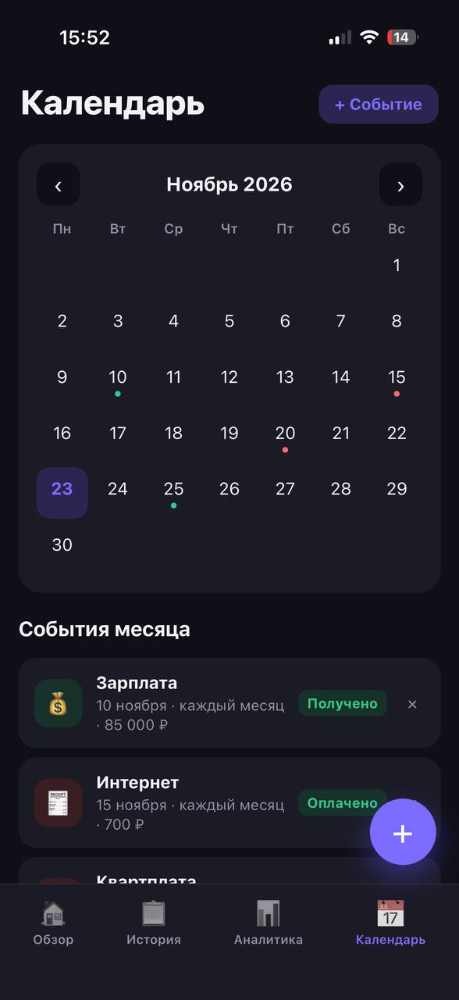

# 💰 Копейка — учёт личных финансов

Веб-приложение для учёта доходов и расходов, которое устанавливается на iPhone и Android как обычное приложение и работает без интернета.

**👉 [Открыть приложение](https://RaseBase.github.io/kopeyka/)**

> Чтобы сразу посмотреть приложение в деле: ⚙️ → «Заполнить примерами».

## Возможности

- **Учёт операций:** доходы и расходы с категориями, редактирование и удаление
- **Автоматические категории:** приложение само определяет категорию по названию («Пятёрочка» → Еда)
- **Импорт банковской выписки:** загрузка CSV с автоопределением столбцов, кодировки и защитой от дублей
- **Аналитика:** круговая диаграмма расходов по категориям, график доходов и расходов за 6 месяцев, сравнение с прошлым месяцем
- **Бюджеты:** лимиты по категориям с индикатором превышения
- **Копилки:** цели накоплений с прогнозом даты достижения
- **Календарь платежей:** регулярные платежи и поступления (ежемесячно, ежегодно, разово) с отметкой оплаты
- **История:** поиск, фильтр по месяцам и типу операций
- **Резервная копия:** экспорт и импорт всех данных в JSON
- **PWA:** установка на главный экран, работа офлайн, светлая и тёмная тема

## Технологии

- HTML, CSS, JavaScript без фреймворков и библиотек
- PWA: Web App Manifest и Service Worker для офлайн-режима
- localStorage для хранения данных
- SVG для диаграмм
- Web Share API для сохранения резервной копии на iPhone
- Хостинг на GitHub Pages

## Скриншоты

| Обзор | Аналитика | Календарь |
|---|---|---|
|  |  |  |
## Как запустить локально

1. Скачайте репозиторий
2. Откройте `index.html` в браузере

## Автор

Ваше имя · [Telegram](https://t.me/rasebase) · rasebase62@gmail.com
